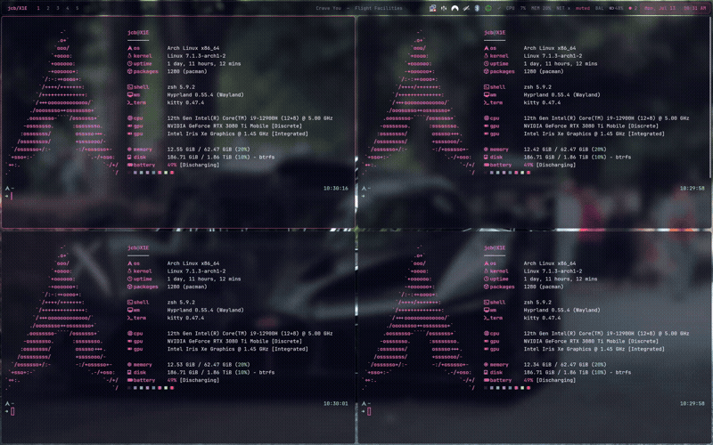

<h1 align="center">
  
  
  
  hyprstatus
</h1>
<br clear="all">

<p align="center">
  A status bar rendered inside the hyprland compositor. Highly customizable. A hyprland specific replacement for waybar.
</p>

> [!WARNING]
> This software is 99% vibe coded with Claude Fable 5, however it has been externally reviewed.
> Use at your own discretion.

## Demo



> Animated preview — [full-quality video](assets/hyprstatus-demo.mp4).

## Why not just Waybar?

| | Waybar | hyprstatus |
|---|---|---|
| process | separate GTK client | inside Hyprland |
| hyprland state (workspaces, titles, submaps) | polled/streamed over IPC sockets | read directly from compositor memory, updated by compositor events the same frame |
| config | JSONC + GTK CSS, own reload | your Hyprland Lua config (`plugin.hyprstatus.*`), atomically re-themed by `hyprctl reload` |
| rendering | GTK, own damage | Hyprland's GL render pass + damage tracking — costs nothing while nothing changes; native blur |
| clicks | layer-shell surface | consumed pre-keybind by the compositor; workspace clicks call dispatchers directly |
| control | signals / waybar-msg | `hl.plugin.hyprstatus.toggle()`, `.refresh([module])` from binds or `hyprctl eval`, `hyprctl hyprstatus` (JSON state) |

## Install

```sh
hyprpm add https://github.com/Tecknich/hyprstatus   # or a local repo path
hyprpm enable hyprstatus
hyprpm reload
```

Load it at login from your Lua autostart:
`hl.on("hyprland.start", function() hl.exec_cmd("hyprpm reload -n") end)`.
Build deps beyond Hyprland headers: `pangocairo`, `libpulse`, `libsystemd`
(sd-bus), `librsvg`, `cairo` — all present on any Arch/Hyprland box.

> [!TIP]
> Install [pyprland](https://github.com/hyprland-community/pyprland) alongside
> hyprstatus. Click actions run arbitrary commands, and pyprland's scratchpads
> are what turn them into Waybar-style dropdowns — `pypr toggle audio` slides a
> floating mixer out from under the bar instead of opening a normal window
> (that's what the demo shows). [`example/pyprland.toml`](example/pyprland.toml)
> ships ready-made scratchpads for the example config's network/audio dropdowns.
> If you don't want to, that's fine too. The example config provides alternatives.

For development: `cmake -B build -S . && cmake --build build` then
`hyprctl plugin load "$PWD/build/hyprstatus.so"` (absolute path required).

## Configure

Hyprland 0.57 configures plugins only through Lua, so everything lives in your
`hyprland.lua`. See [`example/hyprstatus.lua`](example/hyprstatus.lua) for a full
setup (floating themed bar, custom script modules, tray). Configs for older
Hyprland releases (`hyprland.conf` + `hyprstatus-set` keywords) are in the
[`v1.1.0`](https://github.com/Tecknich/hyprstatus/tree/v1.1.0) tree.

Plugins load *after* your config first runs, and Hyprland re-runs it once a
plugin is in. An unknown plugin key is a config error on that first pass, so
guard the block on a sentinel key:

```lua
local function plugin_config_ready(sentinel)
  if not hl.get_config then return false end
  local _, err = hl.get_config(sentinel)
  return err == nil
end

if plugin_config_ready("plugin.hyprstatus.enabled") then
  hl.config({ plugin = { hyprstatus = {
    height = 38, margin = 4, rounding = 6,
    font_family = "JetBrainsMono Nerd Font", font_size = 13,
    modules_left = "workspaces window",
    modules_center = "clock",
    modules_right = "tray network pulseaudio battery",
    col = { background = "rgba(06051aa6)", accent = "rgba(ff6ec7ff)" },
    -- col.foreground, col.border, col.ok, col.warn, col.err, ...
  } } })
end
```

Per-module options use Waybar's option names. `set(module, key, value)` takes
three plain strings, so commas, quotes and real newlines in a value need no
escaping:

```lua
local set, module = hl.plugin.hyprstatus.set, hl.plugin.hyprstatus.module
set("clock", "format", "%a, %b %d   %I:%M %p")
set("battery", "states.warning", "20")
set("network", "on-click-right", "pypr toggle nmtui")   -- pyprland dropdown
```

Custom script modules are Waybar-compatible (`return-type json` with
`{text, alt, tooltip, class, percentage}`, `exec-if`, `interval`, streaming
mode when `interval` is omitted, `signal N`, `max-length`, click/scroll
actions):

```lua
module("nowplaying")
set("nowplaying", "exec", "~/.config/scripts/nowplaying.sh")
set("nowplaying", "return-type", "json")
set("nowplaying", "interval", "2")
set("nowplaying", "on-click", "playerctl play-pause")
```

Toggle the bar or refresh a module (Waybar's `pkill -RTMIN+N waybar`) through the
plugin's Lua functions — Hyprland 0.57 removed plugin dispatchers, so the old
`hyprctl dispatch hyprstatus:*` forms no longer exist:

```lua
hl.bind("SUPER + B", function() hl.plugin.hyprstatus.toggle() end)
```

```sh
hyprctl eval 'hl.plugin.hyprstatus.refresh("mymod")'   # no argument = every module
pkill -RTMIN+9 Hyprland                                 # with set("mymod", "signal", "9")
```

## Modules

`workspaces` (persistent lists, urgent/active states, click/scroll switching;
an open special workspace is always shown with the `special-active` class —
accent by default, restyle via `color.special-active`) ·
`window` · `clock` (colored waybar-style calendar tooltip; right-click for a
full-year view) · `cpu` (per-core tooltip) · `memory` ·
`gpu` (NVIDIA via NVML, AMD via amdgpu sysfs; hover panel with a VRAM bar,
clocks, power, temperature and fan) · `temperature` ·
`battery` (instant AC plug/unplug via udev) · `network` ·
`pulseaudio` (PipeWire via pipewire-pulse) · `power-profiles` · `language` ·
`submap` · `tray` (StatusNotifierItem host; native DBusMenu popups with
per-item icons, submenus, separators, and checkboxes) ·
`notifications` (SwayNotificationCenter) · custom exec modules.

Waybar option names (`format`, `format-icons.<key>`, `states.*`, `interval`,
`on-click*`, `tooltip-format*`, `max-length`, ...) work as you expect.

The `tray` module can filter items: `hide`/`hide-passive` drop items by
Id/Title or Passive status, and `hide-if-bt-disconnected = <item>=<device>`
hides an item unless a BlueZ device matching `<device>` is connected right now
(watched live over the system bus) — handy for apps like librepods that leave a
tray item behind, with stale battery, after the bluetooth device disconnects.

## Interop

On Hyprland >= 0.56, hyprstatus listens for the `gloview:overview` custom bus
event published by the [gloview](https://github.com/Tecknich/gloview) overview
plugin: while an overview is open on a monitor, that monitor's bar hides —
exactly like `hide_on_fullscreen` — and reappears when the overview closes.
Controlled by `plugin.hyprstatus.hide_on_overview` (default on). Load order
does not matter and gloview is optional: without it the event simply never
fires.

## Known limitations

- **Tray menu nesting** is capped at two levels (menu + one submenu column);
  entries nested any deeper are not shown.
- The bar auto-hides over fullscreen windows by default (`hide_on_fullscreen`).
- While a Hyprland config-error banner is visible it shares the reserved-area
  slot with the bar; layout normalizes as soon as the error is fixed.
- One bar; per-monitor different layouts not yet supported (`monitors = `
  restricts which outputs show the bar).

## Compatibility & support

Hyprland plugins are ABI-locked to the exact running compositor build and this
one leans heavily on Hyprland's internal API, so it must be built against the
version you run — always install via `hyprpm`, which does that for you.

`hyprpm add` / `hyprpm update` builds the `commit_pins` entry matching your
Hyprland release, or repo **HEAD** when there is no pin (the current release).
Open an issue with your `hyprctl version` if a build breaks.

| Hyprland | hyprstatus | status |
|---|---|---|
| 0.57.2 | `main` (HEAD) | developed + verified on this; CI builds against Arch's 0.57.2. Lua config only |
| 0.56.0 – 0.56.2 | pinned (`commit_pins`) | previously daily-driven; frozen at the last 0.56.2-verified commit (`001ed5a`) |
| 0.55.4 | pinned (`commit_pins`) | previously daily-driven; frozen at the last 0.55.4-verified commit |

`main` refuses to build against anything older than 0.57 (0.57 replaced the
render, workspace, keybind and config-provider APIs wholesale), so hyprpm on an
older Hyprland always picks the pin.

CI ([`.github/workflows/build.yml`](.github/workflows/build.yml)) builds against
the Hyprland headers Arch ships, on every push/PR and weekly, so upstream API
drift surfaces as a red build rather than a broken install.

> [!NOTE]
> **The bar didn't come back after a system update?** The plugin refuses to load
> when its ABI hash stops matching the compositor's, and that hash is a composite:
> the Hyprland commit *plus* the major.minor of aquamarine, hyprutils, hyprgraphics,
> hyprcursor and hyprlang. So a **dependency** bump breaks loading even when Hyprland
> itself is unchanged — and hyprpm validates its cached headers on the Hyprland commit
> alone, so `hyprpm update` can rebuild plugins against a stale `version.h`. Run
> `hyprctl plugin load /var/cache/hyprpm/$USER/hyprstatus/hyprstatus.so` to see which
> component differs, then `sudo hyprpm update -f` to force a header refresh. If the
> plugin is the *newer* side, the compositor is what needs rebuilding — wait for your
> distro to catch up rather than rebuilding the plugin again.

**Tested environment:** Arch Linux, single monitor, PipeWire (`pipewire-pulse`),
`power-profiles-daemon`, SwayNotificationCenter, and appindicator/SNI tray apps
(NetworkManager, blueman, NordVPN). Other distros, notification daemons, and
multi-monitor setups are expected to work but are less exercised — see **Known
limitations** above. Bug reports welcome.
